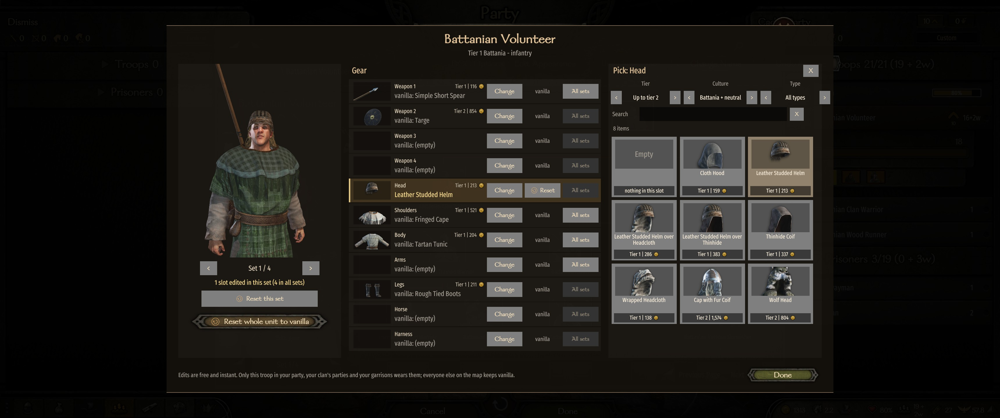
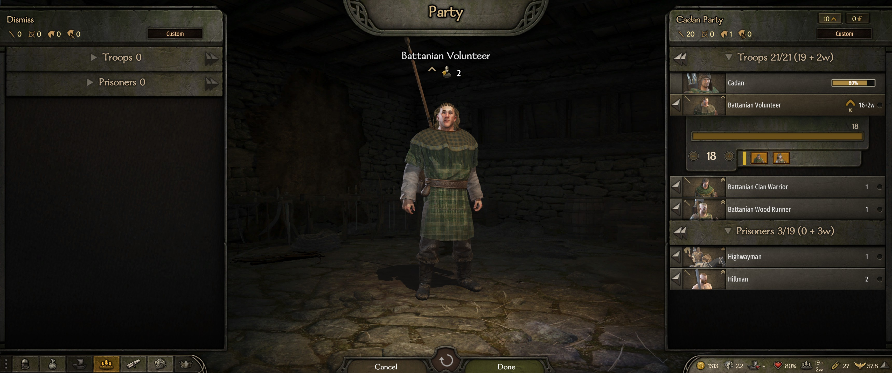
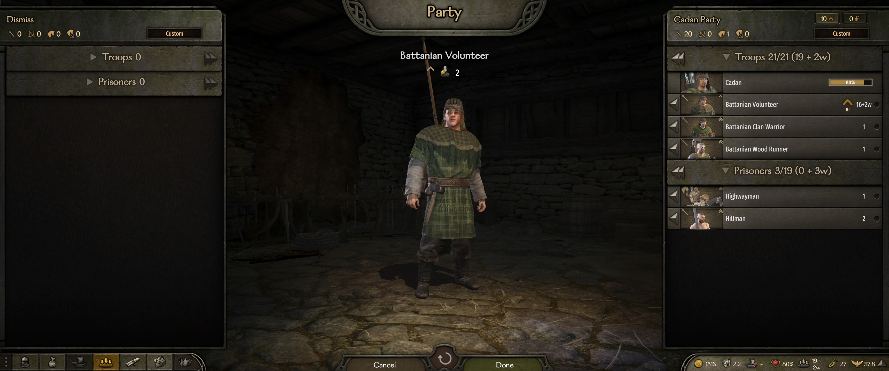

# My Troops' Gear

A mod for Mount & Blade II: Bannerlord.

Made by two of us: the code and all technical work by Claude (Opus 5.5), an AI; the idea, feedback and
playtesting by [Trax](https://github.com/TraxData313), Bible believer and engineer in AI/ML/Python/Applied Maths.

**Change the gear of your own troops - light and easy.** No new troops, no new tree, no mix of special and normal units: you edit the troops you already recruit.

Open any troop in the Encyclopedia - say the Battanian Volunteer - press
**Edit gear** and swap his weapons, armour or horse slot by slot. Only troops of **your** parties wear your
version: your party, your clan's parties and your garrisons. Everyone else in Calradia keeps the vanilla gear.

- A troop has several vanilla gear sets (one Volunteer carries a spear, another a hatchet). Edit each set on its
  own, or press **All sets** on a slot to put that item on every set.
- **Reset** one slot, **Reset this set**, or **Reset whole unit to vanilla**.
- The item picker shows each item's tier and price, and filters by tier, culture and type, or by name.
- On the Encyclopedia page of an edited troop, switch between **Vanilla** and **My version**.
- The party screen shows your troops in their new gear.
- Edits are free and instant, anywhere on the map. Sets you leave alone keep the game's random variety.
- Safe to add or remove mid-campaign: edits are saved as plain text lines.
- Works with [Troop Equipment Upgrade](https://steamcommunity.com/sharedfiles/filedetails/?id=3674824323): it still
  sees the vanilla troop and prices upgrades as before.

| Before | After |
|---|---|
|  |  |

More pictures in [docs/screenshots](docs/screenshots).

## Install

1. Subscribe on the [Steam Workshop](https://steamcommunity.com/sharedfiles/filedetails/?id=3833213221),
   get it from [Nexus Mods](https://www.nexusmods.com/mountandblade2bannerlord/mods/14474),
   or download the zip from the [GitHub Releases page](https://github.com/TraxData313/my-troops-gear/releases/latest).
2. Extract it into `Mount & Blade II Bannerlord\Modules\`.
3. Enable it in the launcher.

Requires [Harmony](https://steamcommunity.com/sharedfiles/filedetails/?id=2859188632) and
[UIExtenderEx](https://steamcommunity.com/sharedfiles/filedetails/?id=2859222409). For Bannerlord v1.4.8,
works with or without War Sails.

## Good to know

- Not for troops that another mod rewrites (My Little Warband and the like): both would change the same soldier.
- Gear counts in battles you fight (field, siege, hideout, at sea). Auto-resolve does not look at gear.
- Formations stay as they are: a spearman you give a bow or a horse still lines up as infantry.
- Heroes, prisoners, tournaments and the arena stay vanilla.

The idea of an in-game gear editor comes from [My Little Warband](https://www.nexusmods.com/mountandblade2bannerlord/mods/3164).
This mod is written from scratch and uses none of its code or files.

Free and open - public domain ([Unlicense](LICENSE)). Do whatever you like with it.

To thank me, open [my GitHub profile](https://github.com/TraxData313) and read my top pinned.

How it works

The details, limits and build steps are in [docs/TECHNICAL.md](docs/TECHNICAL.md).

